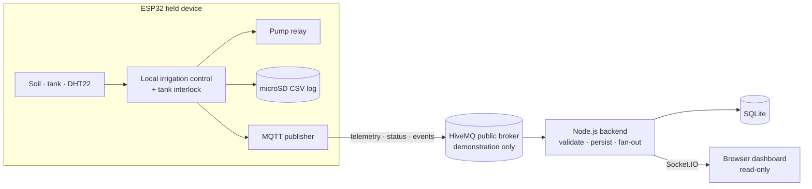

# AquaForge HYDROSYNC — Stage 4

An ESP32-based smart irrigation and monitoring system with authoritative local
control and read-only remote telemetry. Stage 4 extends the Stage 2 irrigation
controller and Stage 3 microSD logger with Wi-Fi/MQTT publishing, a Node.js
ingestion backend, SQLite history, and a real-time browser dashboard.

> **Design principle:** the ESP32 always owns the pump decision. Network outages
> must never disable local sensing, irrigation, or the tank interlock.

---

## Contents

- [Overview](#overview)
- [Architecture](#architecture)
- [Repository layout](#repository-layout)
- [Hardware](#hardware)
- [Prerequisites](#prerequisites)
- [Quick start](#quick-start)
- [Configuration](#configuration)
- [MQTT contract](#mqtt-contract)
- [Control logic](#control-logic)
- [HTTP API](#http-api)
- [Dashboard behaviour](#dashboard-behaviour)
- [Security and deployment notes](#security-and-deployment-notes)
- [Testing and validation](#testing-and-validation)
- [Documentation](#documentation)
- [Licensing](#licensing)

## Overview

HYDROSYNC monitors soil moisture, tank level, temperature, and humidity, then
controls a pump relay locally using hysteresis and a low-tank interlock. Every
five seconds it publishes validated telemetry over MQTT. A Node.js backend
subscribes to the device topics, validates and stores readings in SQLite, and
streams updates to a browser dashboard over Socket.IO.

**Key capabilities**

- Local closed-loop irrigation with soil-moisture hysteresis.
- Low-tank lockout with recovery hysteresis to prevent relay chatter.
- AUTO/MANUAL operating modes with a debounced manual-request input.
- MicroSD CSV logging that continues independently of the network.
- Retained MQTT status with Last Will and Testament (`online` / `offline`).
- Strict backend validation: exact topics, 4 KiB payload cap, schema checks,
  and topic/device identity matching.
- SQLite history with duplicate suppression for retained-message replays.
- Realtime dashboard with freshness tracking, reconnect deduplication, local
  Chart.js, and no CDN dependency.
- **No remote pump control.** Stage 4 is monitoring-only.

## Architecture



The backend never publishes commands. There is no command topic, no pump-control
subscription, and no remote-control UI.

## Repository layout

| Path | Description |
|---|---|
| `Wokwi_Project_Files/` | Ready-to-import Wokwi `sketch.ino`, `diagram.json`, and `libraries.txt`. |
| `firmware/` | ESP32 Stage 4 source and its Wokwi dependency list. |
| `backend/` | Node.js MQTT subscriber, Express API, SQLite storage, Socket.IO, and dashboard. |
| `backend/public/vendor/` | Locally vendored Chart.js 4.4.8. |
| `config/` | MQTT topic and payload contract. |
| `documentation/` | Installation, architecture, pinout, and acceptance test plan. |
| `THIRD_PARTY_NOTICES.md` | Reuse and licensing inventory. |
| `THIRD_PARTY_LICENSES/` | Upstream license texts. |

## Hardware

The reference circuit is an ESP32 DevKit V1 with soil and tank potentiometers, a
DHT22 sensor, pump and low-tank LEDs, a relay module, two slide switches, and a
microSD card.

| Signal | GPIO |
|---|---:|
| Soil potentiometer | 34 |
| Tank potentiometer | 35 |
| DHT22 data | 15 |
| Pump LED | 25 |
| Low-tank LED | 26 |
| AUTO/MANUAL switch | 27 |
| Manual-request switch | 14 |
| Relay IN | 22 |
| microSD CS / SCK / MISO / MOSI | 5 / 18 / 19 / 23 |

See [`documentation/PINOUT.md`](documentation/PINOUT.md) for switch wiring,
active-low relay configuration, and threshold details.

## Prerequisites

- **Node.js 20 or newer** (tested with Node.js 24 and `better-sqlite3` 12).
- **npm**.
- A modern browser.
- A Wokwi account with **network access enabled** for the simulation.
- No local ESP32 toolchain is required for the Wokwi workflow.

## Quick start

### 1. Run the Wokwi simulation

1. Create or open an ESP32 project in Wokwi.
2. Copy the three files from `Wokwi_Project_Files/` into the matching project
   tabs: `sketch.ino`, `diagram.json`, and `libraries.txt`.
3. Enable network access, save, and start the simulation.

The `libraries.txt` contents must be exactly:

```text
DHT sensor library for ESPx
PubSubClient
ArduinoJson
```

> **Library naming:** the Wokwi package is **DHT sensor library for ESPx**, while
> the C++ header remains `DHTesp.h`. Do not add `DHTesp` as a separate dependency.

The supplied diagram boots in **AUTO** mode with the manual request **OFF**.

### 2. Start the backend

```bash
cd backend
cp .env.example .env     # Windows: copy .env.example .env
npm install
npm test
npm start
```

Open <http://localhost:3000>. The server binds to `0.0.0.0` by default; set
`HOST=127.0.0.1` in `.env` to restrict it to the local machine.

Firmware and backend must use the same device ID. The default topic root is
`aquaforge/hydrosync/aqua5-479928426260819969`.

## Configuration

Backend settings are read from `backend/.env`.

| Variable | Default | Purpose |
|---|---|---|
| `PORT` | `3000` | HTTP/Socket.IO listen port. |
| `HOST` | `0.0.0.0` | Bind address; use `127.0.0.1` for local-only access. |
| `MQTT_URL` | `mqtt://broker.hivemq.com:1883` | Broker connection URL. |
| `MQTT_TOPIC_ROOT` | `aquaforge/hydrosync/aqua5-479928426260819969` | Exact topic prefix subscribed by the backend. |
| `DEVICE_ID` | `aqua5-479928426260819969` | Device identity stored and queried by the backend. |
| `STALE_AFTER_SECONDS` | `20` | Age after which the dashboard marks data stale. |
| `DB_PATH` | `./data/hydrosync.sqlite` | SQLite database location. |

`backend/.env`, `node_modules/`, and runtime database files are intentionally
excluded from version control.

## MQTT contract

The firmware derives the topic root from `DEVICE_ID`, keeping the topic and the
payload `device` field in sync. The backend subscribes to exactly three topics:

| Topic suffix | Retained | QoS | Purpose |
|---|---|---|---|
| `/telemetry` | Yes | 0 | Sensor and state snapshot every 5 seconds. |
| `/status` | Yes | 0 | `online`, or Last Will `offline`. |
| `/events` | No | 0 | State transitions such as pump and mode changes. |

Telemetry payload:

```json
{
  "device": "aqua5-479928426260819969",
  "uptime_ms": 125000,
  "soil_pct": 32.0,
  "tank_pct": 76.0,
  "temp_c": 28.5,
  "humidity_pct": 65.2,
  "dht_ok": true,
  "mode": "AUTO",
  "manual_request": false,
  "pump": "ON",
  "tank_lockout": false,
  "sd_ok": true
}
```

`temp_c` and `humidity_pct` are `null` when the DHT22 read is invalid. The
backend rejects unexpected topics, payloads larger than 4 KiB, invalid JSON, and
payloads whose `device` does not match the configured topic root. Retained
telemetry replayed after a restart is deduplicated against the last accepted
sample.

See [`config/MQTT_PROTOCOL.md`](config/MQTT_PROTOCOL.md) for the full schemas.

## Control logic

| Parameter | Value |
|---|---|
| Pump ON | Soil moisture ≤ 30% |
| Pump OFF | Soil moisture ≥ 45% |
| Tank lockout | Tank level < 15% |
| Lockout recovery | Tank level ≥ 20% |
| Switch debounce | 40 ms |
| Telemetry / CSV interval | 5 s |
| DHT22 sample interval | 2.5 s |
| Relay polarity | Active-high by default (`RELAY_ACTIVE_LOW = false`) |

All control decisions execute on the ESP32. The backend and dashboard are
observers only.

## HTTP API

| Endpoint | Description |
|---|---|
| `GET /api/health` | Service health and current MQTT broker connectivity. |
| `GET /api/latest` | Latest reading, device status, and stale threshold. |
| `GET /api/history?limit=N` | Recent readings, 1–500 rows (default 100). |
| `GET /api/events?limit=N` | Recent events, 1–100 rows (default 30). |

API responses are sent with `Cache-Control: no-store` and are rate-limited to
120 requests per minute per client.

## Dashboard behaviour

- Displays soil, tank, temperature, humidity, pump, mode, and interlock state.
- Marks data **stale** when the stored `received_at` age exceeds
  `STALE_AFTER_SECONDS`, rather than presenting an old row as live.
- Shows **DEVICE ONLINE**, **DEVICE STALE**, or **BROKER OFFLINE** based on
  status freshness and broker connectivity.
- Keeps the latest 60 chart samples and deduplicates live messages and history
  by database ID after reconnects.
- Colours health rows teal for healthy, red for failed, and amber for unknown.
- Loads Chart.js from `/vendor/chart.umd.min.js`; no CDN access is required.
- Enforces a strict Content Security Policy through Helmet.

## Security and deployment notes

- The public HiveMQ broker is unauthenticated and shared. Use it only for
  **synthetic Wokwi demonstration data**; topic names are public.
- A production deployment requires a private broker with TLS, authentication,
  and per-device ACLs.
- The backend binds to all interfaces by default. Set `HOST=127.0.0.1` when the
  dashboard should be reachable only from the local machine.
- Never commit `.env` files, credentials, or runtime databases.
- Stage 4 intentionally exposes no actuation path to the network.

## Testing and validation

Run the backend unit tests from `backend/`:

```bash
npm test
```

Status of the current package:

- **Passing:** 13/13 backend unit tests for validation, topic parsing, and
  retained-replay signatures.
- **Verified:** SQLite ingestion, REST endpoints, MQTT ingestion, topic/device
  mismatch rejection, oversized-payload rejection, restart deduplication, and
  dashboard rendering without console errors.
- **Verified:** `Wokwi_Project_Files/sketch.ino` is byte-identical to
  `firmware/AquaForge_HYDROSYNC_Stage4.ino`.
- **Pending (user environment):** Wokwi compilation and the final end-to-end
  Wokwi/browser demonstration. No local ESP32 toolchain is available in this
  package.

Follow [`documentation/TEST_PLAN.md`](documentation/TEST_PLAN.md) for the full
acceptance checklist.

## Documentation

| Document | Contents |
|---|---|
| [`documentation/INSTALLATION.md`](documentation/INSTALLATION.md) | Full setup steps and environment requirements. |
| [`documentation/ARCHITECTURE.md`](documentation/ARCHITECTURE.md) | Data flow, reliability, and read-only boundaries. |
| [`documentation/PINOUT.md`](documentation/PINOUT.md) | Wiring, switch defaults, and thresholds. |
| [`documentation/TEST_PLAN.md`](documentation/TEST_PLAN.md) | Automated and Wokwi/browser acceptance tests. |
| [`config/MQTT_PROTOCOL.md`](config/MQTT_PROTOCOL.md) | Topic, payload, and validation contract. |
| [`backend/README.md`](backend/README.md) | Backend-specific quick reference. |

## Licensing

This repository includes third-party components under their respective
licenses:

| Component | License |
|---|---|
| Chart.js 4.4.8 | MIT |
| DHTesp | GPL-3.0 |
| PubSubClient | MIT |
| ArduinoJson | MIT |
| ESP32 Arduino core | LGPL-2.1 |
| Architecture reference (`danieladarve/greenhouse-monitor`) | MIT |

License texts are included in [`THIRD_PARTY_LICENSES/`](THIRD_PARTY_LICENSES),
and the full inventory is in [`THIRD_PARTY_NOTICES.md`](THIRD_PARTY_NOTICES.md).
No project-level license is declared in this repository; add one before
redistributing the project as a whole.

---

**Repository:**
<https://github.com/ayankunduixb-pixel/AquaForge-HYDROSYNC-Smart-IoT-Based-Irrigation-and-Monitoring-System>
